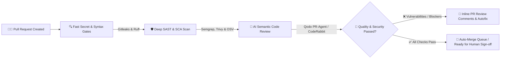

  

# 🚀 Awesome Code Review Automation & DevSecOps Ecosystem 🛡️

### *The definitive directory of AI Pull Request Reviewers, Automated Code Review Platforms, DevSecOps Security Gates, and Self-Hosted Review Bots*

  
  
  
  
  
  

---

## 📌 Table of Contents

- [🌐 Overview & SEO Keywords](#-overview--seo-keywords)
- [📊 Sector Overview & Market Dynamics](#-sector-overview--market-dynamics)
- [🏢 SaaS & Hosted Platforms](#-saas--hosted-platforms)
- [💻 Open-Source GitHub Projects](#-open-source-github-projects)
- [🛠️ Best Practices & Framework Architecture](#️-best-practices--framework-architecture)
- [🤝 How to Contribute](#-how-to-contribute)
- [⭐ Support & Sponsor](#-support--sponsor)
- [📈 Star History](#-star-history)
- [⚖️ Disclaimer](#️-disclaimer)

---

## 🌐 Overview & SEO Keywords

Welcome to the definitive, high-authority knowledge base for **Code Review Automation**, **AI-Powered Pull Request (PR) Reviews**, and **DevSecOps Shift-Left Security Workflows**. 

As engineering teams scale software velocity with generative AI coding assistants, code generation speeds have outstripped human review capacity. This repository curates industry-standard **SaaS/hosted platforms** and **open-source developer tools** designed to:
- 🤖 Automate inline, context-aware pull request and merge request reviews using LLMs (GPT-4o, Claude 3.5 Sonnet, DeepSeek, and local Ollama models).
- 🛡️ Enforce automated **DevSecOps shift-left guardrails**, static application security testing (SAST), software composition analysis (SCA), secret scanning, and infrastructure-as-code (IaC) compliance.
- ⚡ Orchestrate declarative PR workflows, stacked diffs, automated PR summaries, dynamic reviewer routing, and deterministic auto-merge policies across **GitHub**, **GitLab**, **Bitbucket**, and **Azure DevOps**.

> **Target Search Queries & Keywords**: `code review automation`, `ai code review`, `devsecops pull request gates`, `automated pr reviewer`, `sast github action`, `secret scanning git diff`, `coderabbit alternatives`, `qodo pr-agent`, `semgrep code review`, `shift left security`, `llm code inspection`, `continuous code quality`.

---

## 📊 Sector Overview & Market Dynamics

The global **DevSecOps and Application Security Testing (AST)** market is valued at approximately **$8.9B – $11.4B** (growing at a 13%–22% CAGR), while the dedicated automated code review and inspection software segment commands an estimated **$4B+**.

The sector exhibits a **hybrid structure: moderately concentrated at the platform layer with heavy fragmentation across specialized point solutions**:
- **Platform Concentration:** Broad end-to-end enterprise contracts are anchored by major platform providers (such as GitHub, GitLab, Snyk, and SonarSource).
- **Specialized Fragmentation:** The inline AI pull-request review, deterministic PR policy automation, and shift-left scanning niche remains **heavily fragmented**. Startups and open-source projects continually emerge with specialized models, AST parsers, and custom policy engines to protect developer velocity without vendor lock-in.

---

## 🏢 SaaS & Hosted Platforms

The following table summarizes market-leading commercial and hosted SaaS platforms for AI code reviews, pull request intelligence, and DevSecOps quality gates.

*Sorted descending by company size (Valuation / Estimated Revenue).*

| 🏢 Platform | 💰 Company Size (Valuation / Revenue) | 💵 Starting Tier Pricing | 🎁 Free Tier / Trial Limits | 🔍 Core Capabilities |
| :--- | :--- | :--- | :--- | :--- |
| **[Snyk](https://snyk.io)** | **$7.4B** peak private valuation (~$300M+ ARR) | **$25** / contributing dev / month (Team plan) | **Free forever plan**: Up to 100 Snyk Code (SAST) tests/mo, 200 Snyk Open Source (SCA) tests/mo, 100 container tests/mo, capped at 5 projects. | Developer-first DevSecOps scanning code, open-source dependencies, containers, and IaC directly on pull requests. |
| **[SonarQube Cloud](https://sonarsource.com)** | **$4.7B** private valuation (~$430M+ ARR) | **$34** / month (covers up to 100,000 Lines of Code) | **Free forever plan**: Unlimited analysis for public open-source repos; up to 50,000 Lines of Code (LOC) free for private repos. | Cloud continuous inspection enforcing Clean-as-You-Code quality gates, SAST taint analysis, and inline PR decoration. |
| **[CodeRabbit](https://coderabbit.ai)** | **$1.5B** valuation (Series C, 2026) | **$24** / user / month (Essentials, billed annually) or $30 month-to-month | **Free forever plan**: $0 for open-source repositories; includes 14-day full Pro trial for private repos (no credit card required). | Context-aware line-by-line AI PR reviews, automated architectural diagrams, 1-click refactoring, and AST linter integration. |
| **[Graphite](https://graphite.dev)** | **$290M** valuation (Series B; Acquired by Cursor) | **$20** / user / month (Starter plan, billed annually) | **Free forever Hobby plan**: $0 for individual personal repos; includes 30-day free trial of Team plan with full AI reviews. | Stacked pull request workflow platform featuring fast merge queues, CLI integration, and AI review agent feedback. |
| **[Qodo Merge](https://qodo.ai)** *(formerly CodiumAI)* | **$120M** total funding (Series B, 2026) | **$30** / month (Team starter pool of 2,500 credits, ~$0.012/credit) | **14-day free trial**: Full enterprise feature access and up to 100 code reviews per day; free forever for qualified open-source projects. | Enterprise-grade AI PR review suite providing `/review`, `/describe`, automated test generation, and security checks. |
| **[PullRequest](https://pullrequest.com)** *(by HackerOne)* | Part of HackerOne (**$1B+** valuation) | **$129** / dev / month (Team On-Demand); $9 / seat / mo for static analysis | **Free trial**: 14-day free trial on automated static checks; tailored pilot evaluations for on-demand human review. | Dual-engine review platform combining automated static analysis with vetted human security and software engineers on PRs. |
| **[Codacy](https://codacy.com)** | **~$30M** venture funding (~$7.3M+ ARR) | **$15** / dev / month (Pro plan, billed annually) | **Free forever plan**: Unlimited free analysis for public open-source repos; 14-day free trial for private repos without credit card. | Automated code review and static analysis checking code complexity, test coverage thresholds, and security compliance. |
| **[Bito](https://bito.ai)** | **~$10M** total seed & seed-extension funding | **$15** / seat / month (Team plan) or $12 / seat / mo billed annually | **Free forever plan**: $0 for individual developers with basic AI repo summaries and 100 code completions/month. | AI code review agent providing codebase-aware PR feedback, style-guide enforcement, and prompt-driven context inside Git. |
| **[What The Diff](https://whatthediff.ai)** | Bootstrapped AI SaaS (~$500k ARR) | **$19** / month (Pro plan with 200,000 monthly tokens) | **Free forever plan**: 25,000 tokens per month (~10 pull request diff summaries per month) with unlimited repos. | Token-based AI pull request assistant that writes natural-language diff summaries, changelogs, and inline refactoring hints. |
| **[Reviewpad Cloud](https://reviewpad.com)** | Seed-stage *(GitHub app in maintenance mode)* | **Contact maintainers** (Cloud tiers deprecated; OSS available) | **Free tier**: Free for open-source repositories via GitHub Marketplace app. | Pull request automation engine allowing engineering teams to define auto-merge, reviewer assignment, and PR size labeling as code. |

---

## 💻 Open-Source GitHub Projects

The following curated open-source projects power self-hosted AI code reviews, DevSecOps CI/CD security gates, and PR automation.

*Sorted descending by GitHub Star Count.*

| 📦 Repository & Name | ⭐ GitHub Stars | 🏷️ Primary Category | 📝 Description |
| :--- | :--- | :--- | :--- |
| **[astral-sh/ruff](https://github.com/astral-sh/ruff)** |  | ⚡ Fast Python Linter & Formatter | Extremely fast Python linter and code formatter written in Rust; replaces Flake8, Black, isort, and Bandit in CI/CD PR checks. |
| **[aquasecurity/trivy](https://github.com/aquasecurity/trivy)** |  | 🛡️ Container, IaC & SCA Scanner | Comprehensive open-source DevSecOps scanner for pull requests checking container images, lockfile dependencies, and Terraform/K8s misconfigurations. |
| **[gitleaks/gitleaks](https://github.com/gitleaks/gitleaks)** |  | 🔑 Secret Scanning Gate | Lightning-fast open-source secret-scanning guardrail designed for Git hooks and CI/CD PR checks to detect API keys, tokens, and credentials before merge. |
| **[trufflesecurity/trufflehog](https://github.com/trufflesecurity/trufflehog)** |  | 🔑 Deep Secret Scanner | Finds leaked credentials and sensitive secrets across Git commits, branches, and PR diffs with verified active credential checks. |
| **[Wilfred/difftastic](https://github.com/Wilfred/difftastic)** |  | 🌳 Structural Tree-sitter Diff | Structural AST diff tool that compares code syntax rather than line diffs, making complex code reviews drastically easier to understand. |
| **[golangci/golangci-lint](https://github.com/golangci/golangci-lint)** |  | 🐹 Go Linter Runner | Fast Go linters runner for CI/CD with parallel execution, caching, and GitHub Action pull request annotations. |
| **[semgrep/semgrep](https://github.com/semgrep/semgrep)** |  | 🔍 AST-Aware SAST Engine | Fast, open-source AST-aware SAST engine ideal for DevSecOps PR gates, catching security vulnerabilities and enforcing custom code rules. |
| **[qodo-ai/pr-agent](https://github.com/qodo-ai/pr-agent)** |  | 🤖 Open-Source AI Review Agent | Flagship open-source AI PR reviewer supporting GitHub, GitLab, and Bitbucket with `/review`, `/describe`, `/improve`, and `/ask` commands. |
| **[facebook/infer](https://github.com/facebook/infer)** |  | 🔬 Deep Static Analyzer | Static analyzer for Java, C, C++, and Objective-C that detects null pointer exceptions, memory leaks, and race conditions before merge. |
| **[google/osv-scanner](https://github.com/google/osv-scanner)** |  | 📦 Open Source SCA Scanner | Vulnerability scanner powered by the OSV database, providing automated dependency risk assessment in PR workflows. |
| **[super-linter/super-linter](https://github.com/super-linter/super-linter)** |  | 🧹 Multi-Language Linter Action | Ready-to-use open-source multi-language linting GitHub Action combining 40+ language linters into a single unified PR check. |
| **[reviewdog/reviewdog](https://github.com/reviewdog/reviewdog)** |  | 🐶 Automated Inline PR Annotator | Automated code review tool in Go that pipes output from any linter, SAST scanner, or compiler directly into inline PR comments. |
| **[PyCQA/bandit](https://github.com/PyCQA/bandit)** |  | 🐍 Python AST Security Scanner | Security-focused static analyzer for Python that parses AST trees to find common security issues (SQLi, shell injection, insecure crypto). |
| **[ossf/scorecard](https://github.com/ossf/scorecard)** |  | 🏅 Supply Chain Security Assessor | OpenSSF automated security tool evaluating repos against key supply-chain security criteria (branch protection, pinned dependencies, SAST). |
| **[danger/danger](https://github.com/danger/danger)** |  | 🚨 PR Hygiene & Rules Orchestrator | CI companion tool running automated code-review chores during PRs—enforcing changelog updates, test coverage rules, and PR metadata. |
| **[danger/danger-js](https://github.com/danger/danger-js)** |  | 🚨 JavaScript/TypeScript PR Hygiene | The JavaScript and TypeScript port of Danger for automating PR etiquette, commit linting, and team review conventions. |
| **[anc95/ChatGPT-CodeReview](https://github.com/anc95/ChatGPT-CodeReview)** |  | 🤖 Lightweight LLM PR Bot | Minimalist GitHub Action leveraging OpenAI APIs to post automated line-by-line review comments on PR diffs. |
| **[oxsecurity/megalinter](https://github.com/oxsecurity/megalinter)** |  | 🛠️ 50+ Linters Orchestrator | All-in-one open-source CI/CD linter orchestrator bundling 50+ linters and formatters with automated PR reporting and autofix patches. |
| **[mattzcarey/code-review-gpt](https://github.com/mattzcarey/code-review-gpt)** |  | 🤖 CLI & GitHub Action Reviewer | Open-source CLI and GitHub Action that reviews code changes locally or in CI using OpenAI, Claude, or local model endpoints. |
| **[reviewboard/reviewboard](https://github.com/reviewboard/reviewboard)** |  | 📋 Self-Hosted Code Review Server | Proven self-hosted web-based code and document review platform supporting Git, Subversion, Mercurial, and Perforce. |
| **[GerritCodeReview/gerrit](https://github.com/GerritCodeReview/gerrit)** |  | 🏛️ Formal Patch-Set Review System | Battle-tested web-based code review and Git repository management system featuring granular patch-set diffs and CI voting gates. |

---

## 🛠️ Best Practices & Framework Architecture

To implement a bulletproof, modern automated code review and DevSecOps PR pipeline:

1. **Layer 1: Pre-Commit & In-PR Secret Scanning (0-5s)**: Run **Gitleaks** or **TruffleHog** on PR diffs to block token leaks before external triggers run.
2. **Layer 2: Deterministic Linters & AST Checks (5-20s)**: Execute **Ruff**, **golangci-lint**, or **Super-Linter** with **Reviewdog** to pipe comments directly onto changed lines.
3. **Layer 3: DevSecOps Vulnerability Gates (20-60s)**: Run **Semgrep** for custom AST logic and **Trivy / OSV-Scanner** for dependency CVE alerts.
4. **Layer 4: AI Semantic PR Reviews**: Use **Qodo PR-Agent** or **CodeRabbit** to summarize architectural blast radius, test plan adequacy, and business logic flaws.
5. **Least-Privilege Token Safety**: Configure `GITHUB_TOKEN` with minimal scopes (`contents: read`, `pull-requests: write`) and prevent execution on fork PRs without approval to defend against prompt injection.

---

## 🤝 How to Contribute

We welcome additions, corrections, and tool suggestions from developers and security researchers!

1. 🍴 **Fork** this repository.
2. ✍️ **Add or update** your project in `README.md` following the table schema (include official links, pricing/star badges, and concise descriptions).
3. 🧪 **Verify markdown rendering** and ensure links are functional.
4. 📬 **Submit a Pull Request** with a brief summary of the changes.

---

## ⭐ Support & Sponsor

Thank you for visiting and using this resource! Maintaining a comprehensive, accurate directory of code review automation and DevSecOps tools takes significant research and testing. If you find this curated list valuable for you or your engineering team, please consider supporting the project:

- ⭐ **Star this repository** to show appreciation and help others discover it.
- 🍴 **Fork the repo** to build your team's internal PR checklist or tool evaluation matrix.
- 📢 **Share with your network** on X/Twitter, LinkedIn, and developer communities.
- ☕ **Buy me a coffee / Sponsor**: Support continuous curation and maintenance via the [GitHub Sponsors Dashboard](https://github.com/sponsors/ishandutta2007).

  

---

## 📈 Star History

---

## ⚖️ Disclaimer

- This is a community-maintained curated directory intended for educational and engineering evaluation purposes.
- Mentions of products do not constitute an endorsement.
- Automated tools augment human reviewers; always maintain senior developer architectural and threat modeling review standards.

---

  <b>Built with ❤️ for Software Engineers, DevSecOps Teams, and Open-Source Maintainers.</b>

